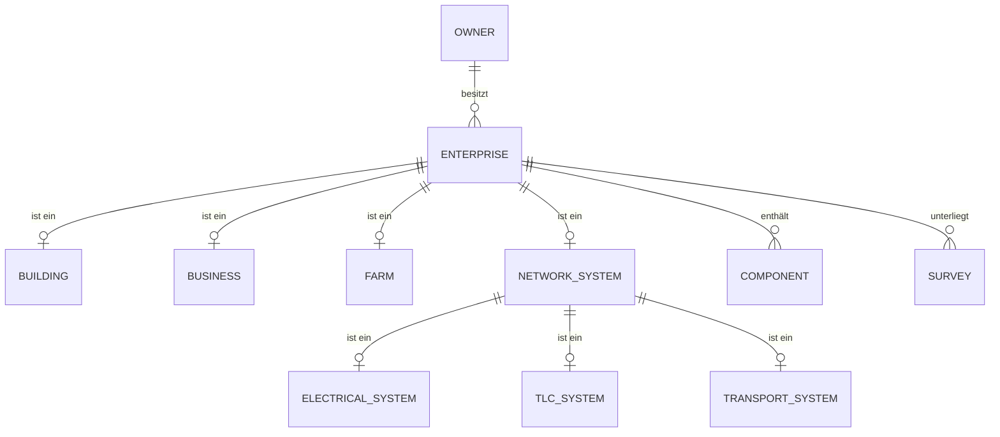
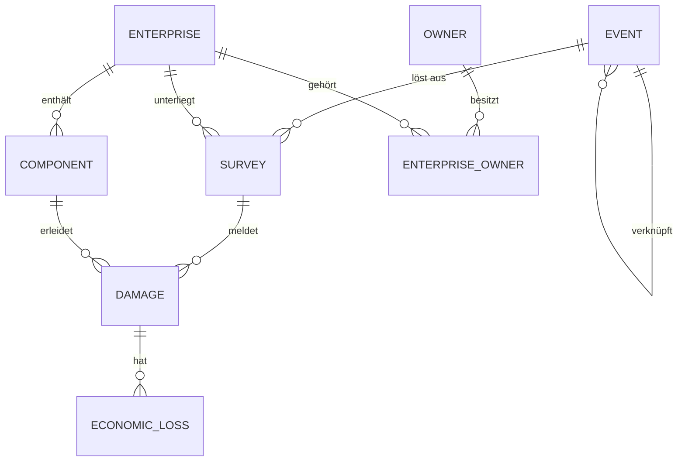

# Schemaübersicht

!!! warning "KI-gestützte Übersetzung"
    Diese Seite wurde mit Unterstützung künstlicher Intelligenz übersetzt und kann Fehler enthalten. Maßgeblich ist die englische Version. Die Namen der Tabellen und Attribute sind in allen Sprachen identisch, da sie der PostgreSQL-Implementierung entsprechen.

Das Schema `public` ist um drei Gruppen von Tabellen herum aufgebaut:

1. **Unternehmen**: die im Besitz befindlichen, verorteten Einheiten, die beschädigt werden können (Gebäude, landwirtschaftliche Betriebe, Gewerbebetriebe, Netzsysteme).
2. **Komponenten**: die physischen oder wirtschaftlichen Elemente, die zu einem Unternehmen gehören (Kulturen, Maschinen, Personal, Straßenabschnitte usw.).
3. **Bewertung**: Ereignisse, Erhebungen und die daraus entstehenden Schadensdatensätze.

Unternehmen und Komponenten nutzen beide die **Vererbung mit einer Tabelle pro Untertyp**: Die Tabelle eines Untertyps teilt den Primärschlüssel der übergeordneten Tabelle, sodass eine Zeile mit `child.id = parent.id` mit ihrer übergeordneten Tabelle verknüpft wird.

Das Schema wird in drei Diagrammen dargestellt, damit jedes übersichtlich bleibt.

## 1. Unternehmen und Eigentum

## 2. Komponenten und ihre Untertypen

```mermaid
erDiagram
    ENTERPRISE ||--o{ COMPONENT : "enthält"
    COMPONENT ||--o{ DAMAGE : "erleidet"

    COMPONENT ||--o| ADDED_BLOCK : "ist ein"
    COMPONENT ||--o| ARTISTIC_GOOD : "ist ein"
    COMPONENT ||--o| BUILDING_COMPONENT : "ist ein"
    COMPONENT ||--o| BUILDING_FUNCTIONALITY : "ist ein"
    COMPONENT ||--o| BUSINESS_OPERATIONS : "ist ein"
    COMPONENT ||--o| LIVESTOCK : "ist ein"
    COMPONENT ||--o| NETWORK_SERVICE : "ist ein"
    COMPONENT ||--o| PRODUCT : "ist ein"
    COMPONENT ||--o| PROVISION : "ist ein"
    COMPONENT ||--o| STAFF : "ist ein"
    COMPONENT ||--o| ELECTRICAL_NETWORK_COMPONENT : "ist ein"
    COMPONENT ||--o| TLC_NETWORK_COMPONENT : "ist ein"
    COMPONENT ||--o| TRANSPORT_NETWORK_COMPONENT : "ist ein"

    COMPONENT ||--o| AGRICULTURE_PRODUCT : "ist ein"
    AGRICULTURE_PRODUCT ||--o| CROP : "ist ein"
    AGRICULTURE_PRODUCT ||--o| STORED : "ist ein"

    COMPONENT ||--o| FIXED_ASSET : "ist ein"
    FIXED_ASSET ||--o| INFRASTRUCTURE : "ist ein"
    FIXED_ASSET ||--o| LAND : "ist ein"
    FIXED_ASSET ||--o| MACHINERY : "ist ein"
    FIXED_ASSET ||--o| MATERIAL : "ist ein"

```

## 3. Wechselwirkungen zwischen Entitäten

### Legende der Beziehungen
* `||--o{` : **Eins-zu-viele**. *Beispiel: Ein Unternehmen enthält viele Komponenten.*
* `||--||` : **Eins-zu-eins**. *Beispiel: Der Datensatz Building ist eine direkte Erweiterung eines Datensatzes Enterprise.*
* `}o--||` : **Viele-zu-eins**. *Beispiel: Viele Unternehmen können zu einem einzigen Eigentümer gehören.*