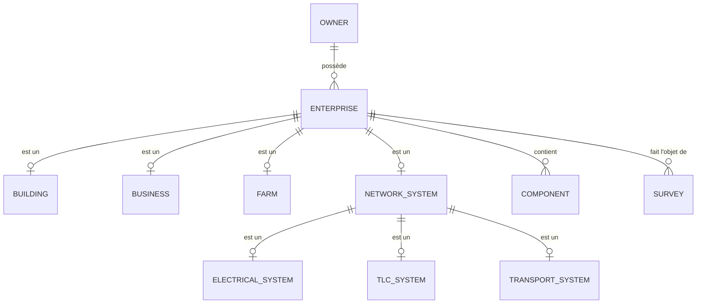
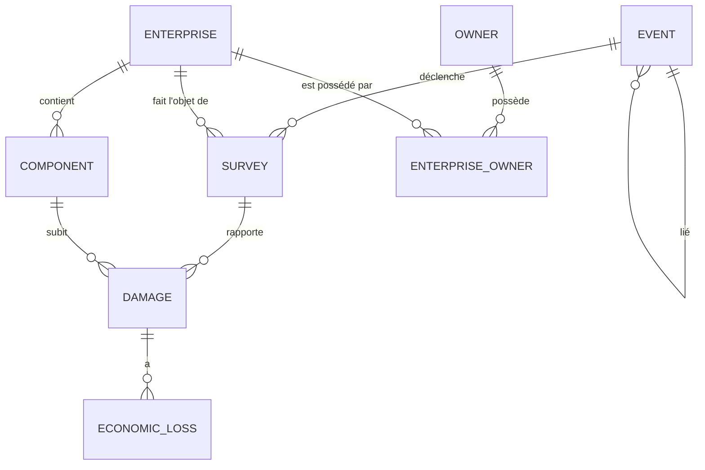

# Aperçu du schéma

!!! warning "Traduction assistée par IA"
    Cette page a été traduite avec l'assistance de l'intelligence artificielle et peut contenir des erreurs. La version anglaise fait foi. Les noms des tables et des attributs sont identiques dans toutes les langues car ils correspondent à ceux de l'implémentation PostgreSQL.

Le schéma `public` est organisé autour de trois groupes de tables :

1. **Entreprises** : les unités détenues et localisées qui peuvent être endommagées (bâtiments, exploitations agricoles, entreprises commerciales, systèmes de réseau).
2. **Composants** : les éléments physiques ou économiques qui appartiennent à une entreprise (cultures, machines, personnel, tronçons de route, etc.).
3. **Évaluation** : les événements, les relevés et les enregistrements de dommages qu'ils produisent.

Les entreprises et les composants utilisent tous deux l'**héritage à une table par sous-type** : la table d'un sous-type partage la clé primaire de sa table parente, de sorte qu'une ligne est jointe à sa table parente avec `child.id = parent.id`.

Le schéma est présenté en trois diagrammes afin que chacun reste lisible.

## 1. Entreprises et propriété

## 2. Composants et leurs sous-types

```mermaid
erDiagram
    ENTERPRISE ||--o{ COMPONENT : "contient"
    COMPONENT ||--o{ DAMAGE : "subit"

    COMPONENT ||--o| ADDED_BLOCK : "est un"
    COMPONENT ||--o| ARTISTIC_GOOD : "est un"
    COMPONENT ||--o| BUILDING_COMPONENT : "est un"
    COMPONENT ||--o| BUILDING_FUNCTIONALITY : "est un"
    COMPONENT ||--o| BUSINESS_OPERATIONS : "est un"
    COMPONENT ||--o| LIVESTOCK : "est un"
    COMPONENT ||--o| NETWORK_SERVICE : "est un"
    COMPONENT ||--o| PRODUCT : "est un"
    COMPONENT ||--o| PROVISION : "est un"
    COMPONENT ||--o| STAFF : "est un"
    COMPONENT ||--o| ELECTRICAL_NETWORK_COMPONENT : "est un"
    COMPONENT ||--o| TLC_NETWORK_COMPONENT : "est un"
    COMPONENT ||--o| TRANSPORT_NETWORK_COMPONENT : "est un"

    COMPONENT ||--o| AGRICULTURE_PRODUCT : "est un"
    AGRICULTURE_PRODUCT ||--o| CROP : "est un"
    AGRICULTURE_PRODUCT ||--o| STORED : "est un"

    COMPONENT ||--o| FIXED_ASSET : "est un"
    FIXED_ASSET ||--o| INFRASTRUCTURE : "est un"
    FIXED_ASSET ||--o| LAND : "est un"
    FIXED_ASSET ||--o| MACHINERY : "est un"
    FIXED_ASSET ||--o| MATERIAL : "est un"

```

## 3. Interactions entre les entités

### Légende des relations
* `||--o{` : **Un-à-plusieurs**. *Exemple : une entreprise contient plusieurs composants.*
* `||--||` : **Un-à-un**. *Exemple : l'enregistrement Building est une extension directe d'un enregistrement Enterprise.*
* `}o--||` : **Plusieurs-à-un**. *Exemple : plusieurs entreprises peuvent appartenir à un même propriétaire.*