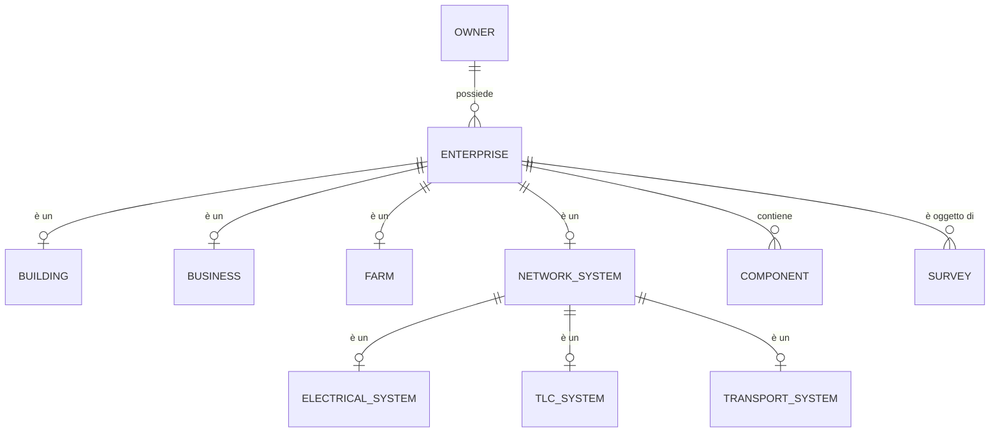
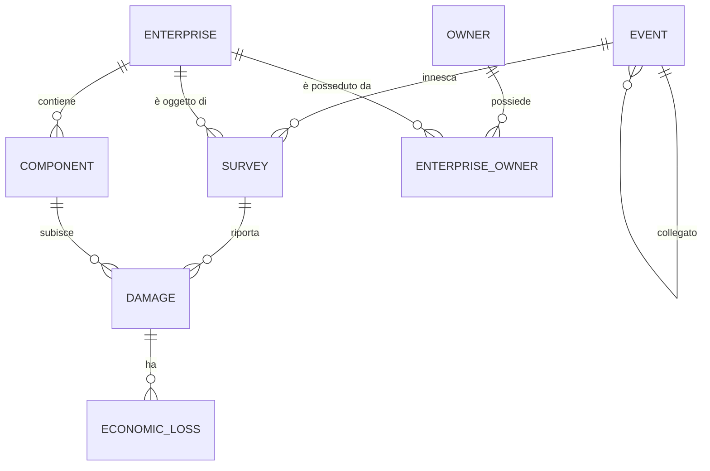

# Panoramica dello schema

!!! warning "Traduzione assistita dall'IA"
    Questa pagina è stata tradotta con l'assistenza dell'intelligenza artificiale e può contenere imprecisioni. La versione inglese è il riferimento. I nomi delle tabelle e degli attributi sono identici in tutte le lingue perché corrispondono a quelli dell'implementazione PostgreSQL.

Lo schema `public` è organizzato in tre gruppi di tabelle:

1. **Imprese**: le unità di proprietà e localizzate che possono subire danni (edifici, aziende agricole, attività commerciali, sistemi di rete).
2. **Componenti**: gli elementi fisici o economici che appartengono a un'impresa (colture, macchinari, personale, tratti stradali e così via).
3. **Valutazione**: eventi, rilevamenti e i record di danno che ne derivano.

Imprese e componenti usano entrambi l'**ereditarietà con una tabella per sottotipo**: la tabella di un sottotipo condivide la chiave primaria della tabella genitore, quindi una riga si collega alla sua tabella genitore con `child.id = parent.id`.

Lo schema è mostrato in tre diagrammi, in modo che ciascuno resti leggibile.

## 1. Imprese e proprietà

## 2. Componenti e relativi sottotipi

```mermaid
erDiagram
    ENTERPRISE ||--o{ COMPONENT : "contiene"
    COMPONENT ||--o{ DAMAGE : "subisce"

    COMPONENT ||--o| ADDED_BLOCK : "è un"
    COMPONENT ||--o| ARTISTIC_GOOD : "è un"
    COMPONENT ||--o| BUILDING_COMPONENT : "è un"
    COMPONENT ||--o| BUILDING_FUNCTIONALITY : "è un"
    COMPONENT ||--o| BUSINESS_OPERATIONS : "è un"
    COMPONENT ||--o| LIVESTOCK : "è un"
    COMPONENT ||--o| NETWORK_SERVICE : "è un"
    COMPONENT ||--o| PRODUCT : "è un"
    COMPONENT ||--o| PROVISION : "è un"
    COMPONENT ||--o| STAFF : "è un"
    COMPONENT ||--o| ELECTRICAL_NETWORK_COMPONENT : "è un"
    COMPONENT ||--o| TLC_NETWORK_COMPONENT : "è un"
    COMPONENT ||--o| TRANSPORT_NETWORK_COMPONENT : "è un"

    COMPONENT ||--o| AGRICULTURE_PRODUCT : "è un"
    AGRICULTURE_PRODUCT ||--o| CROP : "è un"
    AGRICULTURE_PRODUCT ||--o| STORED : "è un"

    COMPONENT ||--o| FIXED_ASSET : "è un"
    FIXED_ASSET ||--o| INFRASTRUCTURE : "è un"
    FIXED_ASSET ||--o| LAND : "è un"
    FIXED_ASSET ||--o| MACHINERY : "è un"
    FIXED_ASSET ||--o| MATERIAL : "è un"

```

## 3. Interazioni tra entità

### Legenda delle relazioni
* `||--o{` : **Uno-a-molti**. *Esempio: un'impresa contiene molti componenti.*
* `||--||` : **Uno-a-uno**. *Esempio: il record Building è un'estensione diretta di un record Enterprise.*
* `}o--||` : **Molti-a-uno**. *Esempio: molte imprese possono appartenere a un unico proprietario.*