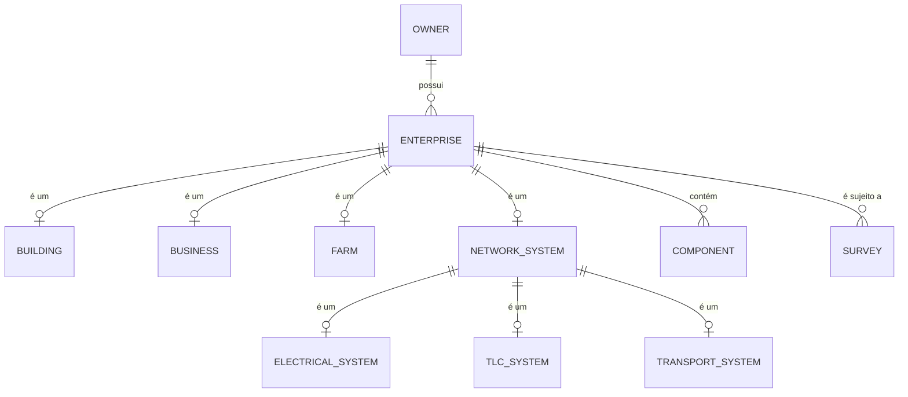
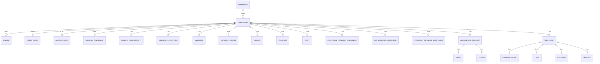
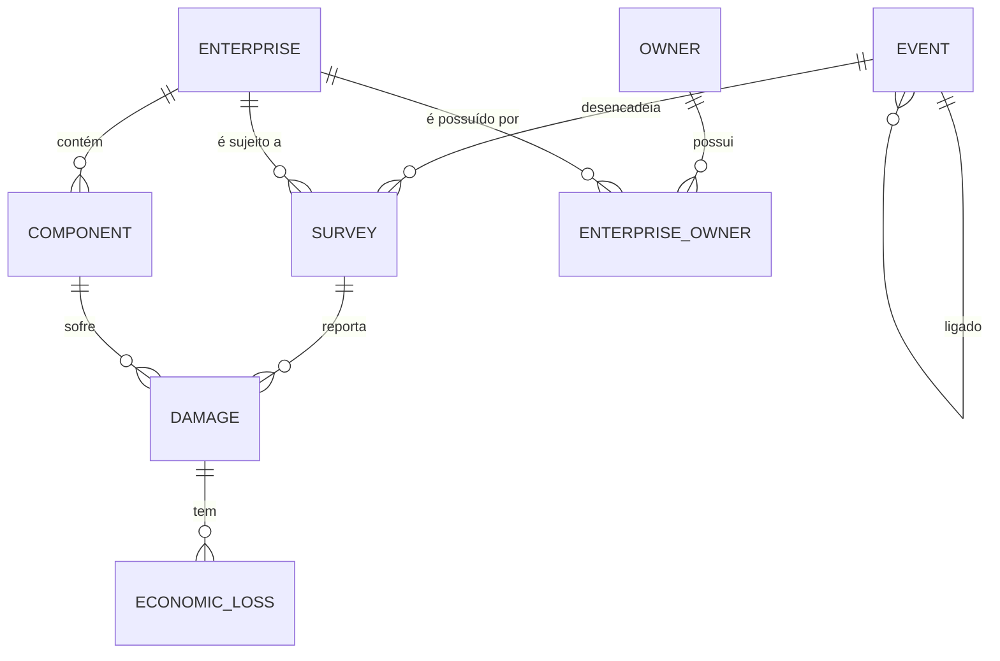

# Visão geral do esquema

!!! warning "Tradução assistida por IA"
    Esta página foi traduzida com a assistência de inteligência artificial e pode conter erros. A versão em inglês é a referência. Os nomes das tabelas e dos atributos são idênticos em todas as línguas porque correspondem aos da implementação PostgreSQL.

O esquema `public` está organizado em três grupos de tabelas:

1. **Empresas**: as unidades detidas e localizadas que podem sofrer danos (edifícios, explorações agrícolas, empresas comerciais, sistemas de rede).
2. **Componentes**: os elementos físicos ou económicos que pertencem a uma empresa (culturas, maquinaria, pessoal, troços de estrada, etc.).
3. **Avaliação**: eventos, levantamentos e os registos de danos que estes originam.

As empresas e os componentes usam ambos a **herança com uma tabela por subtipo**: a tabela de um subtipo partilha a chave primária da tabela-mãe, pelo que uma linha é associada à sua tabela-mãe com `child.id = parent.id`.

O esquema é apresentado em três diagramas para que cada um se mantenha legível.

## 1. Empresas e propriedade

## 2. Componentes e respetivos subtipos

## 3. Interações entre entidades

### Legenda das relações
* `||--o{` : **Um-para-muitos**. *Exemplo: uma empresa contém muitos componentes.*
* `||--||` : **Um-para-um**. *Exemplo: o registo Building é uma extensão direta de um registo Enterprise.*
* `}o--||` : **Muitos-para-um**. *Exemplo: muitas empresas podem pertencer a um único proprietário.*